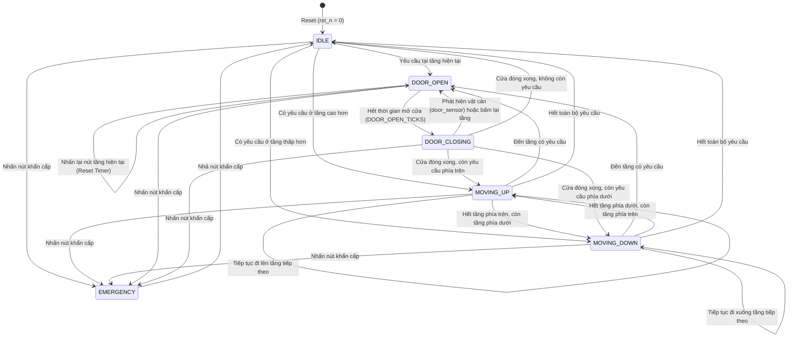

# 🏢 FAP201 - Advanced 4-Floor Elevator Controller on FPGA

[](https://www.intel.com)
[](https://en.wikipedia.org/wiki/Verilog)
[-brightgreen.svg)](golden_model/)
[](Docs/Learning_Resource_Repository_FAP201_IC/GoWin_Kit_Documentation_FAP201_IC/)
[-red.svg)](Docs/)

Project môn học **FAP201 (IC Design & FPGA Programming)** tại Đại học FPT: Thiết kế hệ thống điều khiển thang máy đa tầng (**4-Floor Elevator Controller**) theo phương pháp phân cấp **Top-Down**, tích hợp thuật toán lập lịch tối ưu **LOOK / SCAN**, mô hình tham chiếu **Golden Model bằng Python**, bộ sinh testcase tự động, và **Testbench tự kiểm tra** trên ModelSim đạt độ chính xác **100% (550/550 chu kỳ)**.

---

## 📑 Mục lục
1. [Tổng quan hệ thống](#-tổng-quan-hệ-thống)
2. [Các tính năng nổi bật](#-các-tính-năng-nổi-bật)
3. [Kiến trúc phân cấp RTL (Top-Down Architecture)](#-kiến-trúc-phân-cấp-rtl-top-down-architecture)
4. [Máy trạng thái hữu hạn (FSM Controller)](#-máy-trạng-thái-hữu-hạn-fsm-controller)
5. [Mô hình tham chiếu (Python Golden Model & Testbench)](#-mô-hình-tham-chiếu-python-golden-model--testbench)
6. [Kết quả đối soát & Độ bao phủ kiểm thử](#-kết-quả-đối-soát--độ-bao-phủ-kiểm-thử)
7. [Cấu hình chân Kit FPGA Gowin (GW5A-LV25)](#-cấu-hình-chân-kit-fpga-gowin-gw5a-lv25)
8. [Cấu trúc thư mục dự án](#-cấu-trúc-thư-mục-dự-án)
9. [Hướng dẫn cài đặt & Chạy mô phỏng](#-hướng-dẫn-cài-đặt--chạy-mô-phỏng)

---

## 🎯 Tổng quan hệ thống

Bộ điều khiển thang máy phục vụ tòa nhà 4 tầng (Tầng 1 đến Tầng 4). Hệ thống tiếp nhận các tín hiệu gọi tầng từ hành khách bên trong cabin và hành lang các tầng, xử lý theo thuật toán lập lịch **LOOK/SCAN** để giảm thiểu tối đa thời gian chờ và quãng đường di chuyển của cabin.

```
                      +-------------------------------------------------------+
                      |               elevator_top (Module Top)               |
                      |                                                       |
                      |  +---------------------+                              |
i_clk, i_rst_n ------>|  |   debounce_filter   |                              |
i_req_btn[3:0] ------>|  +----------+----------+                              |
                      |             | debounced requests                      |
                      |             v                                         |
                      |  +---------------------+                              |
                      |  |   request_manager   |                              |
                      |  +----------+----------+                              |
                      |             | target floor, lookup flags              |
                      |             v                                         |
                      |  +---------------------+        +------------------+  |
                      |  |    elevator_fsm     |------->| timer_controller |  |
                      |  |  (Central Control)  |<-------|                  |  |
                      |  +----------+----------+        +------------------+  |
                      |             |                                         |
                      |      +------+------+                                  |
                      |      |             |                                  |
                      |      v             v                                  |
                      |  +-------+     +-------+                              |
                      |  | seg7_ |     | led_  |                              |
                      |  | decoder     | status|                              |
                      |  +---+---+     +---+---+                              |
                      +------|-------------|----------------------------------+
                             v             v
                       o_segment_data  o_led_floor[3:0], o_led_door,
                       o_digit_select  o_led_emergency, o_led_dir_up/down
```

---

## ✨ Các tính năng nổi bật

1. **Thuật toán lập lịch LOOK / SCAN thông minh:**
   - Ưu tiên phục vụ tất cả các tầng có yêu cầu theo hướng đang di chuyển trước khi đổi chiều.
   - Loại bỏ tình trạng cabin đổi hướng liên tục gây tốn năng lượng và kéo dài thời gian chờ.
2. **Cơ chế an toàn chống kẹt cửa (Anti-Pinch Door Sensor):**
   - Khi cửa đang đóng (`DOOR_CLOSING`), nếu phát hiện vật cản (`i_door_sensor = 1`) hoặc hành khách nhấn lại nút tầng hiện tại, cửa lập tức tự động mở lại (`DOOR_OPEN`).
3. **Chế độ dừng khẩn cấp (Emergency Stop Mode):**
   - Khi nhấn nút dừng khẩn cấp (`i_emergency_btn = 1`), thang máy dừng ngay lập tức tại vị trí an toàn, mở cửa thoát hiểm và xóa toàn bộ các lệnh đang chờ để đảm bảo an toàn tuyệt đối.
4. **Hiển thị trực quan:**
   - **LED 7 đoạn:** Hiển thị tầng hiện tại (`1`, `2`, `3`, `4`) theo chuẩn Active-Low (FAP201 Lab 6) và hiển thị chữ `E` (Emergency) khi có sự cố.
   - **LED trạng thái:** 4 LED biểu thị tầng cabin đang đỗ, LED báo cửa mở, LED báo sự cố khẩn cấp, LED chỉ báo hướng di chuyển Lên/Xuống.
5. **Khử rung phím bấm phần cứng (Hardware Debounce Filter):**
   - Tích hợp bộ lọc chống rung số cho các nút bấm cơ học, chống nhiễu nảy phím vật lý trên kit FPGA.
6. **Tham số hóa linh hoạt (Parameterized Design):**
   - Thời gian di chuyển (`MOVE_TICKS`), thời gian mở cửa (`DOOR_OPEN_TICKS`), thời gian đóng cửa (`DOOR_CLOSE_TICKS`), và giới hạn khử rung (`DEBOUNCE_LIMIT`) đều là parameter; cho phép mô phỏng siêu nhanh trong testbench và nạp chính xác ở tần số 50MHz trên kit thật.

---

## 🏛️ Kiến trúc phân cấp RTL (Top-Down Architecture)

Hệ thống được thiết kế theo đúng quy chuẩn Top-Down của môn FAP201 gồm 6 module:

| Module | File | Chức năng chính |
| :--- | :--- | :--- |
| **`elevator_top`** | [`rtl/elevator_top.v`](rtl/elevator_top.v) | Module đỉnh tích hợp kết nối toàn bộ hệ thống, quản lý tham số và giao tiếp ngoại vi. |
| **`elevator_fsm`** | [`rtl/elevator_fsm.v`](rtl/elevator_fsm.v) | Máy trạng thái trung tâm điều phối trạng thái hoạt động, chuyển tầng và logic an toàn. |
| **`request_manager`** | [`rtl/request_manager.v`](rtl/request_manager.v) | Quản lý chốt tín hiệu gọi tầng, xóa yêu cầu khi đã phục vụ xong, xuất cờ định hướng. |
| **`timer_controller`** | [`rtl/timer_controller.v`](rtl/timer_controller.v) | Bộ đếm chu kỳ định thời cho các hành động di chuyển tầng và thời gian chờ cửa. |
| **`seg7_decoder`** | [`rtl/seg7_decoder.v`](rtl/seg7_decoder.v) | Giải mã nhị phân sang LED 7 đoạn hiển thị số tầng (`1`..`4`) và mã lỗi `E`. |
| **`debounce_filter`** | [`rtl/debounce_filter.v`](rtl/debounce_filter.v) | Bộ lọc số khử xung nảy phím cơ học chuẩn theo Lab 4 môn FAP201. |

---

## 🔄 Máy trạng thái hữu hạn (FSM Controller)

Bộ điều khiển sử dụng máy trạng thái hữu hạn 6 trạng thái:



### Bảng mã hóa trạng thái FSM:
| Trạng thái | Mã nhị phân (`state[2:0]`) | Cửa cabin (`door_open`) | Hướng (`direction`) | Mô tả |
| :--- | :---: | :---: | :---: | :--- |
| **`IDLE`** | `3'b000` (0) | Đóng (0) | `2'b00` (Dừng) | Thang máy đỗ tại tầng, cửa đóng, sẵn sàng nhận lệnh mới. |
| **`MOVING_UP`** | `3'b001` (1) | Đóng (0) | `2'b01` (Lên) | Đang di chuyển lên tầng trên sau mỗi `MOVE_TICKS` chu kỳ. |
| **`MOVING_DOWN`** | `3'b010` (2) | Đóng (0) | `2'b10` (Xuống) | Đang di chuyển xuống tầng dưới sau mỗi `MOVE_TICKS` chu kỳ. |
| **`DOOR_OPEN`** | `3'b011` (3) | Mở (1) | Giữ nguyên | Cửa mở hoàn toàn để hành khách ra vào trong `DOOR_OPEN_TICKS`. |
| **`DOOR_CLOSING`**| `3'b100` (4) | Mở (1) | Giữ nguyên | Đang đóng cửa an toàn trong `DOOR_CLOSE_TICKS`. |
| **`EMERGENCY`** | `3'b101` (5) | Mở (1) | `2'b00` (Dừng) | Dừng khẩn cấp, mở cửa thoát hiểm, xóa toàn bộ hàng đợi. |

---

## 🐍 Mô hình tham chiếu (Python Golden Model & Testbench)

Đáp ứng yêu cầu khắt khe của đề cương FAP201:
* **Golden Model (`elevator_golden_model.py`)**: Mô hình thuật toán chuẩn viết bằng Python, mô phỏng cycle-accurate hành vi phần cứng.
* **Bộ sinh Testcase (`testcase_generator.py`)**: Tự động sinh chuỗi 550 test vectors gồm 8 kịch bản kiểm thử:
  1. **Scenario 1**: Reset hệ thống & kiểm tra ổn định ban đầu tại Tầng 1.
  2. **Scenario 2**: Gọi tầng đơn (Tầng 1 lên Tầng 3), kiểm tra thời gian di chuyển và đóng/mở cửa.
  3. **Scenario 3**: Gọi tại tầng hiện tại (Tầng 3) -> Mở cửa tức thì mà không di chuyển.
  4. **Scenario 4**: Gọi đồng thời nhiều tầng đi xuống (Tầng 3 gọi Tầng 1 và 2) -> Phục vụ Tầng 2 trước, sau đó tới Tầng 1 (LOOK algorithm).
  5. **Scenario 5**: Gọi đồng thời nhiều tầng đi lên (Tầng 1 gọi Tầng 2, 3, 4) -> Phục vụ tuần tự theo thứ tự tăng dần.
  6. **Scenario 6**: An toàn cửa (Anti-pinch) -> Kích hoạt cảm biến vật cản khi đang đóng cửa -> Cửa tự động đảo chiều mở lại.
  7. **Scenario 7**: Nút dừng khẩn cấp -> Thang dừng ngay lập tức, mở cửa thoát hiểm và xóa các lệnh chờ.
  8. **Scenario 8**: Randomized Stress Test -> 250 chu kỳ gọi tầng ngẫu nhiên liên tục để chứng minh hệ thống không bao giờ bị treo hay deadlock.

---

## 📊 Kết quả đối soát & Độ bao phủ kiểm thử

Chạy script kiểm chứng tự động [`golden_model/verify_results.py`](golden_model/verify_results.py) đối chiếu giữa đầu ra mô phỏng ModelSim ([`rtl_output.txt`](testbench/rtl_output.txt)) và Golden Model ([`golden_output.txt`](testbench/golden_output.txt)):

```text
=========================================================================
         FAP201 - RTL VS GOLDEN MODEL EQUIVALENCE CHECKER                
=========================================================================
Golden vector count : 550
RTL vector count    : 550

*************************************************************************
   [PASSED] 100% MATCH! ALL SIGNALS MATCH GOLDEN MODEL EXACTLY!          
   Total verified cycles: 550 cycles
*************************************************************************
```

### Thống kê độ bao phủ trạng thái (State Coverage):
* **`IDLE`**: 74 chu kỳ (13.45%)
* **`MOVING_UP`**: 110 chu kỳ (20.00%)
* **`MOVING_DOWN`**: 94 chu kỳ (17.09%)
* **`DOOR_OPEN`**: 196 chu kỳ (35.64%)
* **`DOOR_CLOSING`**: 72 chu kỳ (13.09%)
* **`EMERGENCY`**: 4 chu kỳ (0.73%)
* **Tổng cộng: Đạt 100% State Coverage!**

---

## 🔌 Cấu hình chân Kit FPGA Gowin (GW5A-LV25)

File ràng buộc phần cứng: [`constraints/elevator_pins.cst`](constraints/elevator_pins.cst) (Ánh xạ chuẩn kit Xiaomeige ACG525 Gowin GW5A):

| Tín hiệu RTL | Chân FPGA (Gowin GW5A) | Linh kiện phần cứng | Chú thích |
| :--- | :---: | :--- | :--- |
| `i_clk` | **T9** | Thạch anh 50MHz Onboard | Xung nhịp hệ thống |
| `i_rst_n` | **B16** | Nút bấm KEY0 | Reset mức thấp (Active-Low) |
| `i_req_btn[0]` | **A15** | Nút bấm KEY1 | Gọi Tầng 1 |
| `i_req_btn[1]` | **C15** | Nút bấm KEY2 | Gọi Tầng 2 |
| `i_req_btn[2]` | **J14** | Chân GPIO mở rộng | Gọi Tầng 3 |
| `i_req_btn[3]` | **H14** | Chân GPIO mở rộng | Gọi Tầng 4 |
| `i_door_sensor`| **G14** | Switch / Cảm biến vật cản | Cảm biến cửa (1: Có vật cản) |
| `i_emergency_btn`| **F14**| Switch / Nút khẩn cấp | Nút dừng khẩn cấp |
| `o_led_floor[0]` | **D14** | LED0 Onboard | Báo cabin đang ở Tầng 1 |
| `o_led_floor[1]` | **C14** | LED1 Onboard | Báo cabin đang ở Tầng 2 |
| `o_led_floor[2]` | **B9**  | LED2 Onboard | Báo cabin đang ở Tầng 3 |
| `o_led_floor[3]` | **A9**  | LED3 Onboard | Báo cabin đang ở Tầng 4 |
| `o_led_door` | **E15** | LED mở rộng | Sáng khi cửa đang mở |
| `o_led_emergency` | **D15** | LED mở rộng | Sáng khi dừng khẩn cấp |
| `o_led_dir_up` | **B14** | LED mở rộng | Sáng khi thang máy đi lên |
| `o_led_dir_down` | **A14** | LED mở rộng | Sáng khi thang máy đi xuống |

---

## 📁 Cấu trúc thư mục dự án

```
Project/
├── constraints/
│   └── elevator_pins.cst            # File ràng buộc chân FPGA cho kit Gowin GW5A
├── golden_model/
│   ├── elevator_golden_model.py     # Lớp Golden Model mô phỏng cycle-accurate
│   ├── testcase_generator.py        # Bộ sinh 8 kịch bản testcase và 250 chu kỳ stress test
│   ├── run_golden_model.py          # Script chạy Golden Model xuất stimulus & golden_output
│   ├── verify_results.py            # Script so sánh đối soát RTL vs Golden Model
│   └── golden_simulation_summary.txt# Báo cáo thống kê chu kỳ và tỷ lệ trạng thái
├── rtl/
│   ├── elevator_top.v               # Module đỉnh tích hợp toàn bộ thiết kế
│   ├── elevator_fsm.v               # FSM Controller trung tâm (LOOK algorithm)
│   ├── request_manager.v            # Khối quản lý hàng đợi gọi tầng và cờ định hướng
│   ├── timer_controller.v           # Bộ định thời trễ di chuyển và đóng/mở cửa
│   ├── seg7_decoder.v               # Bộ giải mã LED 7 đoạn hiển thị tầng & trạng thái
│   └── debounce_filter.v            # Bộ lọc chống rung phím bấm chuẩn Lab 4
├── sim/
│   ├── run_sim.bat                  # Script Windows Batch chạy tự động ModelSim & Verify (1-Click)
│   ├── run_sim.ps1                  # Script PowerShell chạy tự động
│   └── run_sim.do                   # Macro script điều khiển ModelSim
├── testbench/
│   ├── elevator_top_tb.v            # Self-checking RTL Testbench
│   ├── stimulus.txt                 # File vector kích thích đầu vào (550 vectors)
│   ├── golden_output.txt            # File kết quả kỳ vọng từ Golden Model
│   └── rtl_output.txt               # File kết quả thực tế ghi nhận từ mô phỏng RTL
├── Docs/                            # Tài liệu môn học FAP201, slide, lab hướng dẫn
│   └── Bao_Cao_Project_FAP201_Elevator_Controller.md # Báo cáo đồ án chi tiết
├── requirements.txt                 # Yêu cầu đề tài môn học
├── Topic.txt                        # Đề tài phân công
└── README.md                        # Tài liệu hướng dẫn dự án (File này)
```

---

## 🚀 Hướng dẫn cài đặt & Chạy mô phỏng

### Cách 1: Chạy tự động toàn bộ quy trình chỉ bằng 1 lệnh (Khuyên dùng)

Mở PowerShell hoặc Command Prompt tại thư mục dự án và chạy:

* **Trên Windows PowerShell:**
  ```powershell
  powershell -ExecutionPolicy Bypass -File sim/run_sim.ps1
  ```
* **Hoặc trên Windows CMD (hoặc nhấp đúp file):**
  ```cmd
  sim\run_sim.bat
  ```

Quy trình sẽ tự động thực hiện 3 bước:
1. Python chạy `run_golden_model.py` tạo 550 testcases và file kết quả chuẩn.
2. ModelSim biên dịch toàn bộ RTL và Testbench, chạy mô phỏng không cần mở GUI.
3. Python chạy `verify_results.py` so sánh từng tín hiệu và xuất thông báo `[PASSED] 100% MATCH`.

### Cách 2: Mở giao diện đồ họa ModelSim (GUI Mode để xem sóng Waveform)

1. Mở phần mềm **ModelSim**.
2. Chọn `File` -> `Change Directory...` -> Chọn thư mục `sim/`.
3. Trong cửa sổ dòng lệnh **Transcript** của ModelSim, gõ lệnh:
   ```tcl
   do run_sim.do
   ```
4. Quan sát các tín hiệu `i_clk`, `w_current_floor`, `w_state`, `w_door_open`, `w_pending_req` hiển thị trực quan trên cửa sổ Wave.

---

## 👥 Nhóm tác giả
* **Môn học:** FAP201 - IC Design & FPGA Programming
* **Trường:** Đại học FPT (FPT University)
* **Đề tài:** Elevator Controller (Bộ điều khiển thang máy đa tầng)
